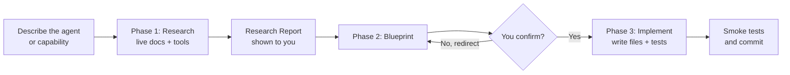
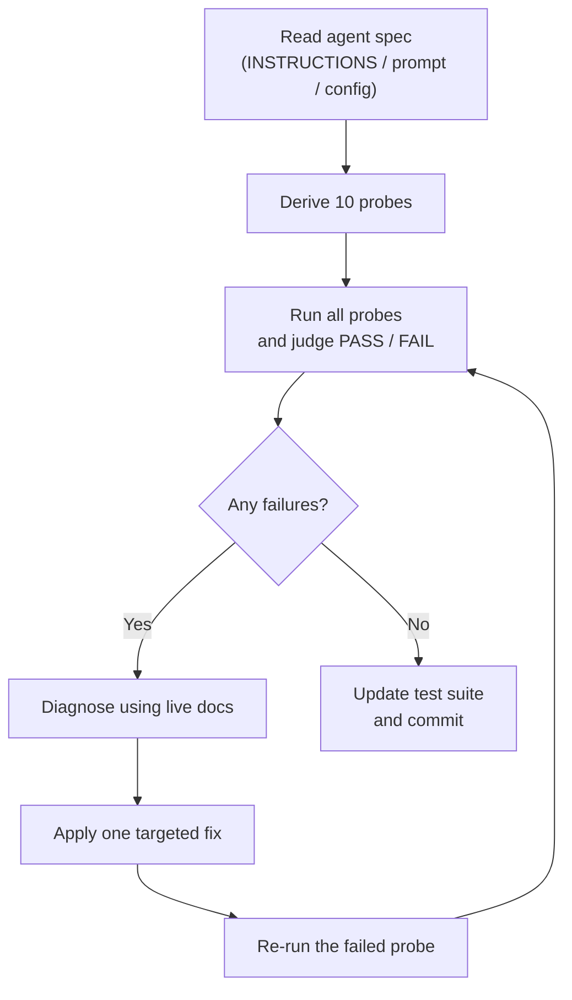
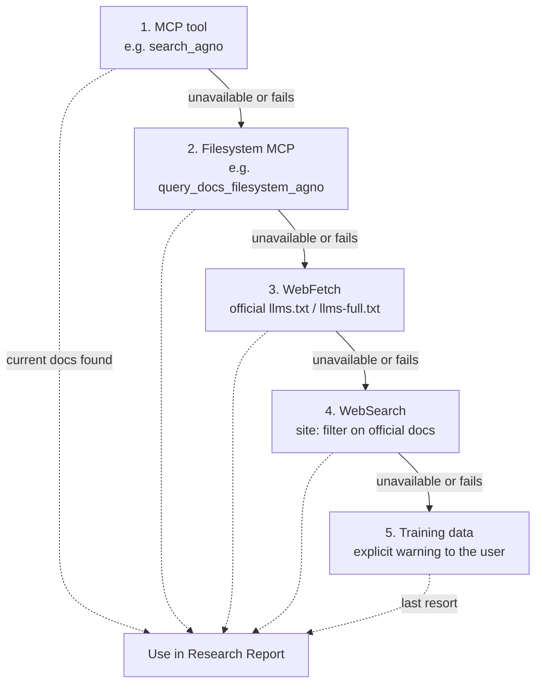

<div align="center">


# Recursive Agentic Improvements

**Three Claude Code skills that create, improve, and extend AI agents across Agno, CrewAI, LangGraph, and Google ADK, for any domain.**

[](https://github.com/exponen-agi/recursive-agentic-improvements/actions/workflows/ci.yml)
[](LICENSE)
[](installer/package.json)
[](https://claude.com/claude-code)
[](#supported-frameworks)

[Landing page](https://cloudbloqavi.github.io/recursive-agentic-improvements/) ·
[Quickstart](QUICKSTART.md) ·
[Contributing](CLAUDE.md) ·
[Security](SECURITY.md)

</div>

---

## Table of contents

- [What and why](#what-and-why)
- [The three skills](#the-three-skills)
- [How it works](#how-it-works)
- [Supported frameworks](#supported-frameworks)
- [Install](#install)
- [Set up documentation MCP servers](#set-up-documentation-mcp-servers)
- [Usage examples](#usage-examples)
- [Repository structure](#repository-structure)
- [Design principles](#design-principles)
- [Contributing and testing](#contributing-and-testing)
- [Security](#security)
- [License](#license)

---

## What and why

Agent frameworks change their APIs faster than any model's training data. A skill that answers from memory can confidently emit an import path or decorator that no longer exists. These skills make Claude Code **research live documentation first**, show you a plan, and only write code after you confirm it.

- **Any domain, no templates.** A legal-document summariser and a DevOps pipeline go through the same flow. The research phase does the discovery, so the skills stay domain-agnostic.
- **Research before code.** Live docs are queried and a Research Report is shown before anything is written.
- **You stay in control.** Every skill stops at a Blueprint and waits for your explicit confirmation before it touches your files.
- **Spec-driven improvement.** `/improve-agent` derives its probes from the agent's own instructions, not from generic expectations.

### What it is not

This is **not** a framework, a library, or an agent runtime. It ships Markdown skill files that install into *your* projects. Generated agents live in your project, not in this repository.

---

## The three skills

Each skill is a self-contained Markdown file in [`.claude/commands/`](.claude/commands/). It works when copied on its own into any project.

| Command | What it does | Flow | Skill file |
|---|---|---|---|
| `/create-agent` | Builds a new agent from a free-form description | Research, Plan, Scaffold | [create-agent.md](.claude/commands/create-agent.md) |
| `/improve-agent` | Derives 10 probes from the agent's spec, runs them, fixes failures, iterates | Spec, Probes, Fix, Iterate | [improve-agent.md](.claude/commands/improve-agent.md) |
| `/extend-agent` | Adds a new capability to an existing agent without regressions | Research, Plan, Implement | [extend-agent.md](.claude/commands/extend-agent.md) |

---

## How it works

### Create and extend: research, blueprint gate, implement

No file is written before the Blueprint is confirmed.



### Improve: the recursive loop



The 10 probes are: golden path (3), edge case (2), tool selection (2), constraint (2), adversarial (1).

### Documentation fallback chain

Each step is tried only when the one above it is unavailable or fails. Training data is the last resort, and the user is warned before it is used.



An interactive version is on the [landing page](https://cloudbloqavi.github.io/recursive-agentic-improvements/#fallback).

---

## Supported frameworks

| Framework | Min version tested | Docs source | MCP URL | Key note |
|---|---|---|---|---|
| Agno | 2.9.0 | MCP + llms-full.txt | `https://docs.agno.com/mcp` | Use `Claude(id=...)` for Anthropic models; memory uses `SqliteDb` + `add_history_to_context=True` |
| CrewAI | 1.15.28 | MCP + llms.txt | `https://docs.crewai.com/mcp` | `crewai create crew <slug>` to scaffold |
| LangGraph | 1.2.11 | MCP + llms.txt | `https://docs.langchain.com/mcp` | `create_react_agent` moved to `langchain.agents.create_agent` (V1.0+); tracing needs `LANGSMITH_API_KEY` |
| Google ADK | 2.9.1 | Context7 (`/google/adk-python`) + WebFetch llms.txt | `https://mcp.context7.com/mcp` | `root_agent` must be defined in `agent.py`; no ADK-dedicated MCP server exists, so general-purpose Context7 is used |

Reference guides for each framework live under [`docs/`](docs/):

| Framework | Use cases |
|---|---|
| Agno | [Chatbot](docs/agno/chatbot/create-new-agent.md) · [Research Assistant](docs/agno/research-assistant/create-new-agent.md) |
| CrewAI | [Content Pipeline](docs/crewai/content-pipeline/create-new-agent.md) · [Research Crew](docs/crewai/research-crew/create-new-agent.md) |
| LangGraph | [ReAct Agent](docs/langgraph/react-agent/create-new-agent.md) · [Multi-Agent Supervisor](docs/langgraph/multi-agent-supervisor/create-new-agent.md) |
| Google ADK | [Chatbot](docs/google-adk/chatbot/create-new-agent.md) · [Tool-Using Agent](docs/google-adk/tool-using-agent/create-new-agent.md) |

Universal runbooks: [create](docs/create-new-agent.md) · [improve](docs/improve-agent.md) · [extend](docs/extend-agent.md)

---

## Install

Run from inside your target project. Requires Node.js 18 or newer.

```bash
# Claude Code (default) -> .claude/commands/
npx github:cloudbloqavi/recursive-agentic-improvements
```

Other agentic tools take `--agent <name>`:

| Flag | Tool | Installs into |
|---|---|---|
| *(default)* | Claude Code | `.claude/commands/` |
| `cursor` | Cursor | `.cursor/rules/` |
| `copilot` | GitHub Copilot | `.github/instructions/` |
| `roo` | Roo Code | `.roo/rules/` |
| `windsurf` | Windsurf | `.windsurf/rules/` |
| `codex` | OpenAI Codex | `.` (project root) |
| `antigravity` | Google Antigravity | `.agents/rules/` |

```bash
npx github:cloudbloqavi/recursive-agentic-improvements --agent cursor
```

**From a local clone:**

```bash
npx ./installer /path/to/your-project
npx ./installer /path/to/your-project --agent cursor
```

**Manual copy (no Node.js):**

```bash
mkdir -p .claude/commands && cp <repo>/.claude/commands/*.md .claude/commands/
```

Windows and more detail: [QUICKSTART.md](QUICKSTART.md#step-1-install-the-skills-into-your-project).

---

## Set up documentation MCP servers

Recommended, not required: without them the skills fall back to WebFetch and WebSearch. Add to `~/.claude/settings.json` (or the project's `.claude/settings.json`), then restart Claude Code:

```json
{
  "mcpServers": {
    "agno-docs":      { "type": "http", "url": "https://docs.agno.com/mcp" },
    "langchain-docs": { "type": "http", "url": "https://docs.langchain.com/mcp" },
    "crewai-docs":    { "type": "http", "url": "https://docs.crewai.com/mcp" },
    "context7":       { "type": "http", "url": "https://mcp.context7.com/mcp" }
  }
}
```

Set an LLM API key in your project (for example `ANTHROPIC_API_KEY` or `GOOGLE_API_KEY`); see [`.env.example`](.env.example).

---

## Usage examples

```text
/create-agent agno         then describe: "a travel assistant that books flights and hotels"
/create-agent crewai       then describe: "a competitive intelligence crew"
/create-agent langgraph    then describe: "a DevOps automation agent"
/create-agent google-adk   then describe: "a medical appointment scheduler"

/improve-agent agno agents/my-bot/agent.py
/improve-agent crewai src/my-crew

/extend-agent langgraph src/my-agent
/extend-agent google-adk my_agent
```

Run a command with no arguments and it asks for what it needs. New to agents? Start with the [Quickstart](QUICKSTART.md).

---

## Repository structure

```text
.claude/commands/   The three skills (primary artifact; these ship to users)
docs/               Per-framework reference guides and the landing page source
installer/          npx installer package (kept in sync with the skills)
tests/              Offline, mock-based showcase agents per framework
QUICKSTART.md       5-minute guide
CLAUDE.md           Contributor rules and invariants
SECURITY.md         Vulnerability reporting
```

---

## Design principles

- **Research before code.** MCP, then filesystem MCP, then WebFetch, then WebSearch, then training data with a warning.
- **Blueprint is a hard gate.** Nothing is written until you confirm.
- **The spec is the source of truth.** Probes come from the agent's own instructions.
- **Deterministic tests.** Showcase tests use mocked models, so they run offline with no API keys.

---

## Contributing and testing

Read [CLAUDE.md](CLAUDE.md) first; it is the contribution guide (core invariants, skill and docs contracts, commit conventions). Two repo-specific points:

- `.gitignore` excludes `*.md` and most code files. Force-add intentional files with `git add -f <path>`, and never run `git add .` or `git add -A`.
- Use conventional commits, for example `docs(readme): ...`, on a feature branch.

Each framework showcase under `tests/<framework>/` is an isolated [`uv`](https://docs.astral.sh/uv/) project and runs offline:

```bash
cd tests/agno && uv sync && uv run pytest   # likewise crewai, langgraph, google_adk
```

See [tests/README.md](tests/README.md) and the [Test Constitution](tests/TEST_CONSTITUTION.md).

---

## Security

This repository ships Markdown and an installer, with no server and no runtime. Report concerns privately through the repository's **Security** tab; see [SECURITY.md](SECURITY.md).

---

## License

[MIT](LICENSE)
